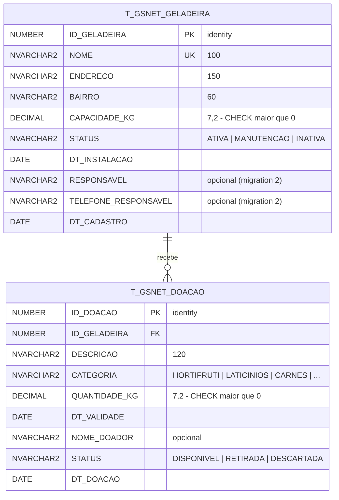

# Geladeira Solidária Inteligente: API .NET

**Global Solution 2026/2 · CitizenTech · FIAP, 2º ano de ADS**
**Disciplina:** Advanced Business Development with .NET

| Integrante | RM | Turma |
|---|---|---|
| Ruan Ribeiro | 567693 | 2TDSPA |

**Vídeo de demonstração:** https://youtu.be/wZetgJfhDLk

---

## 1. O problema e a solução

Geladeiras solidárias são geladeiras instaladas em espaços públicos, onde comércios e moradores deixam alimentos e qualquer pessoa retira o que precisa. O problema é que ninguém sabe, de longe, quanto espaço cada uma tem, o que está para vencer ou quais estão paradas. Doações chegam numa geladeira lotada enquanto outra, a poucos bairros dali, está vazia, e comida vence sem ser distribuída.

Esta API cuida do **cadastro da rede**: as geladeiras e as doações que entram nelas. Com isso ela consegue:

- calcular a **ocupação** de cada geladeira (kg disponíveis, kg livres e %);
- **recusar doações** que não cabem, que vão para uma geladeira fora de operação ou que já chegam vencidas, e **sugerir outra geladeira** com espaço;
- montar a **lista do que vence primeiro**, para os voluntários distribuírem antes de estragar;
- registrar quando o alimento foi **retirado** ou **descartado**.

**ODS:** 2 (Fome zero), 10 (Redução das desigualdades) e 11 (Cidades e comunidades sustentáveis).

## 2. Tecnologias

.NET 8 · ASP.NET Core Web API (controllers) · Entity Framework Core 8 · Oracle.EntityFrameworkCore (provider oficial da Oracle) · EF Core Migrations · Data Annotations · ProblemDetails (RFC 7807) · Swagger (Swashbuckle)

## 3. Modelo de dados

Duas entidades em relacionamento **1:N**: uma geladeira recebe muitas doações; cada doação pertence a uma única geladeira.



| Classe C# | Tabela | Relacionamento no EF Core |
|---|---|---|
| `Geladeira` | `T_GSNET_GELADEIRA` | `ICollection<Doacao> Doacoes` (lado 1) |
| `Doacao` | `T_GSNET_DOACAO` | `int GeladeiraId` + `Geladeira Geladeira` (lado N) |

O relacionamento está em `Data/Configurations/DoacaoConfiguration.cs`, com `HasOne(...).WithMany(...).HasForeignKey(...)` e `OnDelete(DeleteBehavior.Restrict)`: o banco não deixa apagar uma geladeira que tem histórico de doações.

As tabelas e colunas têm nomes em maiúsculas para o `SELECT` no SQL Developer funcionar sem aspas. O prefixo `T_GSNET_` evita conflito com as tabelas da disciplina de Banco de Dados, que ficam no mesmo usuário Oracle.

## 4. Migrations

Nenhuma tabela é criada à mão. O banco inteiro vem de três migrations versionadas em `src/GeladeiraSolidaria.Api/Migrations`:

| # | Migration | O que faz |
|---|---|---|
| 1 | `CriarTabelas` | Cria as duas tabelas, PKs, FK, índices, a UNIQUE do nome e as CHECKs de capacidade, quantidade, status e categoria |
| 2 | `AdicionarResponsavelGeladeira` | Evolução do modelo: adiciona `RESPONSAVEL` e `TELEFONE_RESPONSAVEL` na geladeira |
| 3 | `DadosIniciais` | Carga de teste: 10 geladeiras em bairros de São Paulo e 24 doações. As datas são relativas a `SYSDATE`, então o cenário funciona em qualquer dia |

Todas têm `Down`, então dá para voltar: `dotnet ef database update 0` apaga tudo e `dotnet ef database update` recria.

## 5. Como rodar

**Pré-requisitos:** .NET 8 SDK e um usuário no Oracle (o da FIAP serve).

> No Windows, o SDK instala pelo terminal: `winget install Microsoft.DotNet.SDK.8`

### 5.1 Configurar a conexão (sem senha no código)

A connection string **não fica no repositório**: o `appsettings.json` traz o campo vazio. Ela fica nos *User Secrets* do .NET, que são guardados no seu usuário do Windows, fora da pasta do projeto.

```bash
git clone https://github.com/Ruan-Ribeiro00/geladeira-solidaria-dotnet.git
cd geladeira-solidaria-dotnet

dotnet user-secrets set "ConnectionStrings:Oracle" "User Id=SEU_RM;Password=SUA_SENHA;Data Source=oracle.fiap.com.br:1521/ORCL" --project src/GeladeiraSolidaria.Api
```

Troque `SEU_RM` (ex.: `rm567693`) e `SUA_SENHA`. Outra opção é a variável de ambiente `ConnectionStrings__Oracle` com o mesmo valor.

### 5.2 Criar o banco pelas Migrations

O `dotnet-ef` já vem configurado no projeto como ferramenta local (`.config/dotnet-tools.json`), então não precisa instalar nada global:

```bash
dotnet tool restore
dotnet ef database update --project src/GeladeiraSolidaria.Api
```

Saída esperada: `Applying migration '..._CriarTabelas'`, `'..._AdicionarResponsavelGeladeira'`, `'..._DadosIniciais'` e `Done.`

### 5.3 Subir a API

```bash
dotnet run --project src/GeladeiraSolidaria.Api
```

| O quê | URL |
|---|---|
| Swagger (documentação e testes) | http://localhost:5188/swagger |
| OpenAPI (JSON) | http://localhost:5188/swagger/v1/swagger.json |

No Visual Studio ou no Rider, basta abrir o `GeladeiraSolidaria.sln` e rodar o perfil `http`, que já abre o Swagger.

## 6. Endpoints

### Geladeiras

| Método | Rota | Descrição | Sucesso | Erros |
|---|---|---|---|---|
| `GET` | `/api/geladeiras?bairro=&status=&pagina=1&tamanhoPagina=10` | Lista paginada com filtros. A busca por bairro ignora acentos e maiúsculas (`heliopolis` acha "Heliópolis") | 200 | 400 |
| `GET` | `/api/geladeiras/{id}` | Detalhe com ocupação calculada | 200 | 404 |
| `GET` | `/api/geladeiras/{id}/doacoes?status=` | Doações daquela geladeira (o lado N) | 200 | 404 |
| `POST` | `/api/geladeiras` | Cadastra | 201 + `Location` | 400, 409 |
| `PUT` | `/api/geladeiras/{id}` | Atualiza | 204 | 400, 404, 409, 422 |
| `DELETE` | `/api/geladeiras/{id}` | Exclui (só sem histórico de doações) | 204 | 404, 409 |

### Doações

| Método | Rota | Descrição | Sucesso | Erros |
|---|---|---|---|---|
| `GET` | `/api/doacoes?geladeiraId=&status=&venceEmDias=&pagina=1&tamanhoPagina=10` | Lista paginada, do que vence primeiro ao que vence depois | 200 | 400 |
| `GET` | `/api/doacoes/{id}` | Detalhe, com `diasParaVencer` | 200 | 404 |
| `POST` | `/api/doacoes` | Registra uma doação | 201 + `Location` | 400, 404, 422 |
| `PUT` | `/api/doacoes/{id}` | Corrige uma doação ainda disponível | 204 | 400, 404, 422 |
| `PATCH` | `/api/doacoes/{id}/status` | Marca como `RETIRADA` ou `DESCARTADA` | 204 | 400, 404, 422 |
| `DELETE` | `/api/doacoes/{id}` | Exclui uma doação registrada por engano | 204 | 404 |

### Exemplo de corpo (POST /api/doacoes)

```json
{
  "geladeiraId": 3,
  "descricao": "Marmitas de arroz, feijão e frango",
  "categoria": "MARMITAS",
  "quantidadeKg": 6,
  "dataValidade": "2026-11-20",
  "nomeDoador": "Cozinha Solidária do Capão"
}
```

Datas no formato `AAAA-MM-DD`. Status e categorias em maiúsculas, iguais ao banco.

## 7. Regras de negócio

| Regra | Onde | Resposta |
|---|---|---|
| Doação só entra em geladeira **ATIVA** | `DoacaoService.CriarAsync` | 422 |
| Alimento **vencido** não é aceito | `DoacaoService.GarantirDentroDaValidade` | 422 |
| A doação precisa **caber** no espaço livre. Se não couber, a mensagem sugere a geladeira ativa com mais espaço | `DoacaoService.GarantirEspacoAsync` | 422 |
| Doação já retirada ou descartada **não pode ser alterada** nem voltar a ficar disponível | `DoacaoService.AtualizarAsync` / `AlterarStatusAsync` | 422 |
| A capacidade de uma geladeira não pode ficar **abaixo do que já está dentro** | `GeladeiraService.AtualizarAsync` | 422 |
| Não existem duas geladeiras com o **mesmo nome** (sem diferenciar acentos e maiúsculas) | `GeladeiraService.GarantirNomeUnicoAsync` + índice único | 409 |
| Geladeira com **histórico de doações** não é excluída (use o status `INATIVA`) | `GeladeiraService.ExcluirAsync` + FK `Restrict` | 409 |

**Para ver no Swagger, com o banco recém-criado:**

- `POST /api/doacoes` com `geladeiraId: 2` e `quantidadeKg: 10`: a Heliópolis tem só 5 kg livres, a resposta é 422 e sugere a Itaquera.
- `POST /api/doacoes` com `geladeiraId: 7`: a Brasilândia está em `MANUTENCAO`, 422.
- `DELETE /api/geladeiras/1`: tem doações, 409. `DELETE /api/geladeiras/10` (Jaraguá, sem doações): 204.

## 8. Validação e erros

Os DTOs (`Dtos/`) usam **Data Annotations**: `[Required]`, `[StringLength]`, `[Range]`, `[RegularExpression]` (telefone), `[EnumDataType]` e `IValidatableObject` (data de instalação no futuro). Como os controllers têm `[ApiController]`, um corpo inválido nem chega ao serviço: a resposta é **400** com a lista de campos.

Todos os erros saem no mesmo formato **ProblemDetails** (RFC 7807). Os 400 vêm do `InvalidModelStateResponseFactory` no `Program.cs`, e os 404, 409 e 422 do `GlobalExceptionHandler`, que converte as exceções da camada de serviço:

```json
{
  "type": "https://tools.ietf.org/html/rfc4918#section-11.2",
  "title": "Regra de negócio violada",
  "status": 422,
  "detail": "A doação de 10 kg não cabe na geladeira 'Geladeira Solidária Heliópolis' (5 kg livres). Sugestão: 'Geladeira Solidária Itaquera' (Itaquera, id 4) tem 80 kg livres.",
  "instance": "/api/doacoes"
}
```

| Status | Quando |
|---|---|
| 200 | Consulta |
| 201 | Criado, com o cabeçalho `Location` apontando para o recurso |
| 204 | Atualizado ou excluído |
| 400 | Campo inválido, JSON malformado ou parâmetro fora do intervalo |
| 404 | Geladeira ou doação inexistente |
| 409 | Nome repetido ou exclusão de geladeira com histórico |
| 422 | Regra de negócio (seção 7) |
| 500 | Erro inesperado (o detalhe vai para o log, não para o cliente) |

## 9. Conferindo no Oracle

Depois do `database update`, no SQL Developer:

```sql
SELECT * FROM "__EFMigrationsHistory";

SELECT * FROM T_GSNET_GELADEIRA ORDER BY ID_GELADEIRA;

SELECT d.ID_DOACAO, g.NOME AS GELADEIRA, d.DESCRICAO, d.QUANTIDADE_KG, d.DT_VALIDADE, d.STATUS
  FROM T_GSNET_DOACAO d
  JOIN T_GSNET_GELADEIRA g ON g.ID_GELADEIRA = d.ID_GELADEIRA
 ORDER BY d.ID_DOACAO DESC;

-- Ocupação de cada geladeira (o mesmo cálculo que a API faz)
SELECT g.NOME, g.CAPACIDADE_KG,
       NVL(SUM(CASE WHEN d.STATUS = 'DISPONIVEL' THEN d.QUANTIDADE_KG END), 0) AS OCUPACAO_KG
  FROM T_GSNET_GELADEIRA g
  LEFT JOIN T_GSNET_DOACAO d ON d.ID_GELADEIRA = g.ID_GELADEIRA
 GROUP BY g.NOME, g.CAPACIDADE_KG
 ORDER BY OCUPACAO_KG DESC;
```

## 10. Estrutura

```
geladeira-solidaria-dotnet
├── GeladeiraSolidaria.sln
├── .config/dotnet-tools.json        dotnet-ef como ferramenta local
└── src/GeladeiraSolidaria.Api
    ├── Controllers/                 GeladeirasController e DoacoesController
    ├── Data/
    │   ├── AppDbContext.cs          DbSets e a função de busca sem acento
    │   └── Configurations/          mapeamento Fluent API de cada tabela
    ├── Dtos/                        records de entrada e saída, com validação
    ├── Exceptions/                  exceções e o GlobalExceptionHandler
    ├── Migrations/                  as três migrations versionadas
    ├── Models/                      entidades e enums
    ├── Services/                    regras de negócio
    ├── Program.cs                   injeção de dependência, EF Core, Swagger
    └── appsettings.json             sem connection string (ela vem dos User Secrets)
```

## 11. Uso de IA generativa

Este projeto foi desenvolvido com apoio do Claude (Anthropic) para gerar a estrutura inicial do código, os dados de teste e a documentação. Todo o código foi revisado, executado e testado pelo integrante, que é responsável pelo conteúdo entregue.
